

<picture><source media="(prefers-color-scheme: dark)" srcset="./assets/hello/hero-dark.svg"></picture>

<a href="https://www.linkedin.com/in/tanmay-kala/"><picture><source media="(prefers-color-scheme: dark)" srcset="./assets/hello/dock-linkedin-dark.svg"></picture></a>
<a href="https://x.com/Tanmayai23"><picture><source media="(prefers-color-scheme: dark)" srcset="./assets/hello/dock-x-dark.svg"></picture></a>
<a href="mailto:tanmaykala171206@gmail.com"><picture><source media="(prefers-color-scheme: dark)" srcset="./assets/hello/dock-email-dark.svg"></picture></a>
<a href="https://www.tanmaykala.dev/"><picture><source media="(prefers-color-scheme: dark)" srcset="./assets/hello/dock-portfolio-dark.svg"></picture></a>
<a href="https://github.com/tanmayai23"><picture><source media="(prefers-color-scheme: dark)" srcset="./assets/hello/dock-github-dark.svg"></picture></a>

  

<picture><source media="(prefers-color-scheme: dark)" srcset="./assets/hello/section-01-dark.svg"></picture>
<picture><source media="(prefers-color-scheme: dark)" srcset="./assets/hello/about-dark.svg"></picture>

  

<picture><source media="(prefers-color-scheme: dark)" srcset="./assets/hello/section-02-dark.svg"></picture>
<picture><source media="(prefers-color-scheme: dark)" srcset="./assets/hello/stack-dark.svg"></picture>

  

<picture><source media="(prefers-color-scheme: dark)" srcset="./assets/hello/section-03-dark.svg"></picture>
<a href="https://swachhvan.vercel.app/"><picture><source media="(prefers-color-scheme: dark)" srcset="./assets/hello/project-swachhvan-dark.svg"></picture></a>
<a href="https://github.com/tanmayai23/Hey-Dude-Voice-Assistant"><picture><source media="(prefers-color-scheme: dark)" srcset="./assets/hello/project-heydude-dark.svg"></picture></a>
<a href="https://github.com/tanmayai23/CALL-E-Hackathon"><picture><source media="(prefers-color-scheme: dark)" srcset="./assets/hello/project-marketbuddy-dark.svg"></picture></a>
<a href="https://github.com/tanmayai23/gtsrb-traffic-sign-recognition"><picture><source media="(prefers-color-scheme: dark)" srcset="./assets/hello/project-trafficsign-dark.svg"></picture></a>
<a href="https://aitravelassist.vercel.app/"><picture><source media="(prefers-color-scheme: dark)" srcset="./assets/hello/project-travel-dark.svg"></picture></a>

<a href="https://whisper-ai-transcription.vercel.app/"><picture><source media="(prefers-color-scheme: dark)" srcset="./assets/hello/more-whisper-dark.svg"></picture></a>
<a href="https://vibehub-liard.vercel.app/"><picture><source media="(prefers-color-scheme: dark)" srcset="./assets/hello/more-vibehub-dark.svg"></picture></a>
<a href="https://github.com/tanmayai23?tab=repositories"><picture><source media="(prefers-color-scheme: dark)" srcset="./assets/hello/more-repos-dark.svg"></picture></a>

  

<picture><source media="(prefers-color-scheme: dark)" srcset="./assets/hello/section-04-dark.svg"></picture>
<picture><source media="(prefers-color-scheme: dark)" srcset="./assets/hello/achievement-01-dark.svg"></picture>
<picture><source media="(prefers-color-scheme: dark)" srcset="./assets/hello/achievement-02-dark.svg"></picture>
<picture><source media="(prefers-color-scheme: dark)" srcset="./assets/hello/achievement-03-dark.svg"></picture>
<picture><source media="(prefers-color-scheme: dark)" srcset="./assets/hello/achievement-04-dark.svg"></picture>

  

<picture><source media="(prefers-color-scheme: dark)" srcset="./assets/hello/section-05-dark.svg"></picture>

<picture>
  <source media="(prefers-color-scheme: dark)" srcset="https://raw.githubusercontent.com/tanmayai23/tanmayai23/output/snake-dark.svg">
  
</picture>

<picture><source media="(prefers-color-scheme: dark)" srcset="https://github-readme-stats.vercel.app/api?username=tanmayai23&show_icons=true&include_all_commits=true&count_private=true&bg_color=161B22&title_color=F5F5F7&text_color=D0D7DE&icon_color=8AB4F8&ring_color=4285F4&hide_border=true&border_radius=24&custom_title=GitHub%20stats"></picture>
<picture><source media="(prefers-color-scheme: dark)" srcset="https://streak-stats.demolab.com?user=tanmayai23&background=161B22&border=30363D&stroke=30363D&ring=4285F4&fire=EA4335&currStreakNum=F5F5F7&sideNums=F5F5F7&currStreakLabel=8AB4F8&sideLabels=8B949E&dates=8B949E&hide_border=true&border_radius=24"></picture>

  

<a href="mailto:tanmaykala171206@gmail.com"><picture><source media="(prefers-color-scheme: dark)" srcset="./assets/hello/footer-dark.svg"></picture></a>

